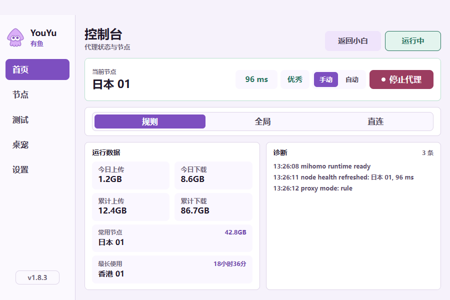
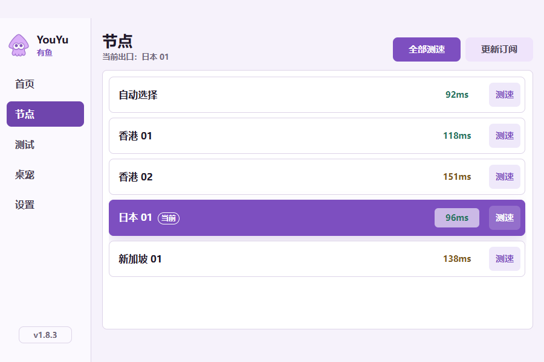
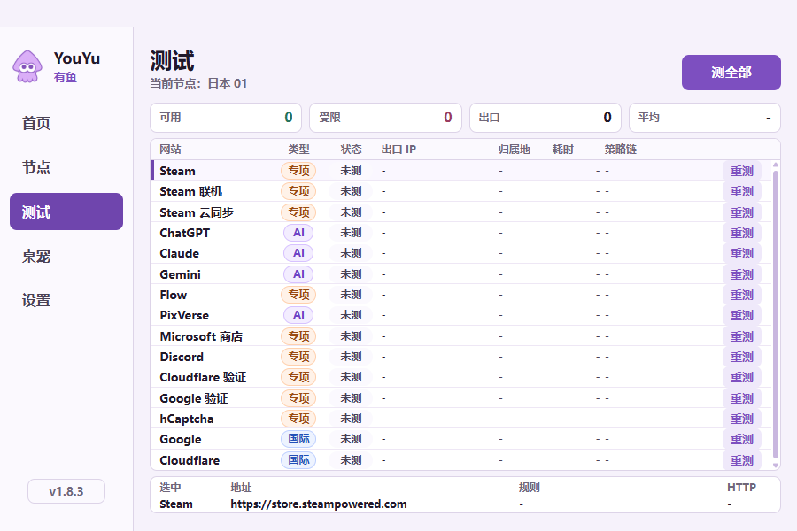
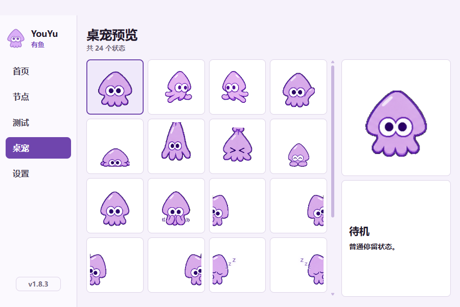
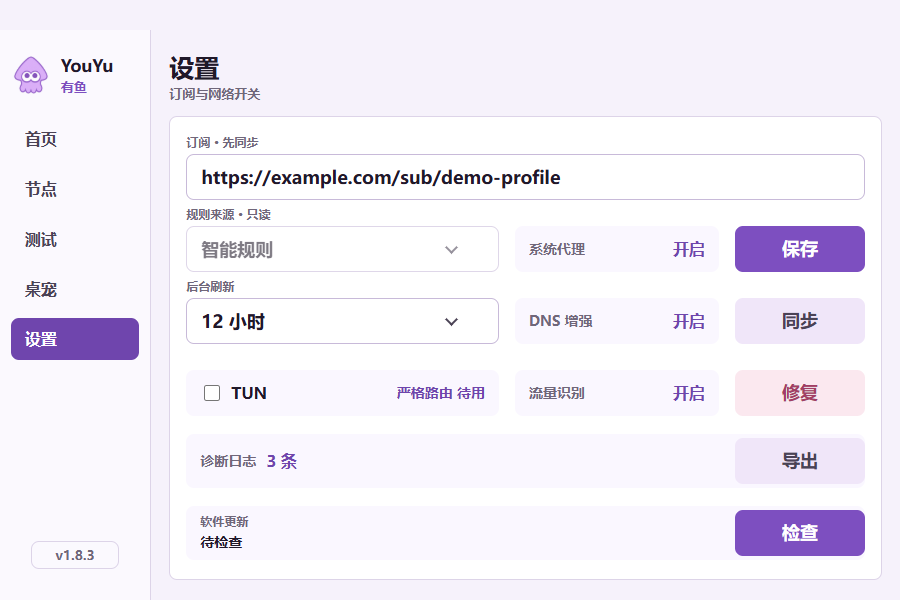
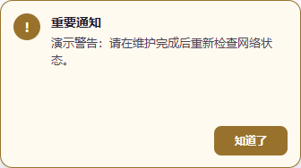

# YouYu：Windows Mihomo 桌面客户端

[](https://github.com/fishknowsss/YouYu/releases/latest)
[](https://github.com/fishknowsss/YouYu/actions/workflows/validate.yml)
[](https://github.com/fishknowsss/YouYu/actions/workflows/build-windows.yml)
[](https://github.com/fishknowsss/YouYu/releases/latest)
[](https://fishknowsss.github.io/YouYu/)

YouYu 是一款面向 Windows x64 的 Mihomo 桌面客户端，提供代理启停、节点选择与健康检查、连通性测试、流量统计、系统网络修复、自动更新、桌宠交互和轻量云端管理。

当前版本为 [`1.8.3`](https://github.com/fishknowsss/YouYu/releases/tag/v1.8.3)。[下载标准版](https://github.com/fishknowsss/YouYu/releases/download/v1.8.3/YouYu-1.8.3-x64.exe) · [下载无桌宠版](https://github.com/fishknowsss/YouYu/releases/download/v1.8.3/YouYu-1.8.3-x64-no.exe)。其他通道、更新文件和校验清单见 [最新稳定 Release](https://github.com/fishknowsss/YouYu/releases/latest)，版本演进见 [CHANGELOG](CHANGELOG.md)。

## 近期改进

- 小白模式连接按钮使用启动、连接、关闭、停止和失败五态图形反馈，并支持系统减少动态效果设置。
- 网络修复、异常恢复和端口变化后保持系统代理与实际运行状态一致；崩溃前未结算流量可从本地日志恢复。
- 云端支持多人定向通知与已读进度、用户配置覆盖和订阅周期流量统计。
- 1.8.3 更新 Electron 43 系列和相关依赖的安全修复，补齐 MIT 许可与第三方声明，更新贡献说明和项目主页。

## 界面预览

截图使用可重复的安全演示数据。常规界面按 `900×600` 窗口采集；通知卡片按实际 `336×188` 独立窗口采集。订阅使用 `example.com`，出口 IP 使用 RFC 文档保留地址，节点、流量、测速、策略链和诊断内容均为虚构演示数据。

<table>
  <tr>
    <td width="50%" valign="top">
      <a href="docs/screenshots/home-easy.png"></a>
      <h3>小白模式</h3>
      <p>一个入口启停代理，用五态图形反馈连接进度和结果。</p>
    </td>
    <td width="50%" valign="top">
      <a href="docs/screenshots/home-advanced.png"></a>
      <h3>专业模式</h3>
      <p>查看当前节点、健康状态、流量、常用节点与诊断日志。</p>
    </td>
  </tr>
  <tr>
    <td width="50%" valign="top">
      <a href="docs/screenshots/nodes.png"></a>
      <h3>节点管理</h3>
      <p>手动切换、单节点测速、全部测速与订阅更新，延迟同步到首页。</p>
    </td>
    <td width="50%" valign="top">
      <a href="docs/screenshots/connectivity-test.png"></a>
      <h3>连通性测试</h3>
      <p>集中查看 15 项服务的可用性、耗时、出口信息和策略链。</p>
    </td>
  </tr>
  <tr>
    <td width="50%" valign="top">
      <a href="docs/screenshots/pet-preview.png"></a>
      <h3>桌宠预览</h3>
      <p>预览 24 种桌宠状态；也可选择完全不含桌宠的独立安装通道。</p>
    </td>
    <td width="50%" valign="top">
      <a href="docs/screenshots/settings.png"></a>
      <h3>设置与修复</h3>
      <p>管理订阅、规则、TUN 与后台刷新，执行网络修复、诊断导出和软件更新。</p>
    </td>
  </tr>
  <tr>
    <td width="50%" valign="top">
      
      <h3>定向通知</h3>
      <p>向指定用户发送纯文本提示或警告，跟踪各设备的已读进度。</p>
    </td>
    <td width="50%" valign="top">
      <h3>开始使用</h3>
      <p>下载安装包，完成使用登记并保存自己的订阅，然后启动代理。公开安装包均不内置订阅。</p>
      <p><a href="https://fishknowsss.github.io/YouYu/">查看项目主页</a> · <a href="https://github.com/fishknowsss/YouYu/releases/latest">下载最新版本</a></p>
    </td>
  </tr>
</table>

## 核心能力

### 两种使用模式

- **小白模式**：以单一主操作完成代理启停，减少日常操作成本。
- **专业模式**：提供控制台、节点、测试、桌宠和设置等完整页面。
- 可从专业模式返回小白模式；小白模式保留隐藏的专业模式入口，避免误触复杂功能。
- 专业模式左下角版本号可进入独立的重新登记界面，用于切换当前用户；云端激活前失败会保留原用户，激活成功后的配置或运行时异常则保留已切换的新用户并写入诊断。

### 代理与节点

- 内置 Mihomo Windows x64 运行时，无需单独安装核心。
- 支持规则、全局和直连三种代理模式。
- 支持自动选择与手动节点切换；自动模式默认日本优先，并在日本节点不可用时提示后回退到其他健康节点。
- 支持单节点测速、全部测速、取消测速和订阅更新；全部测速运行中仍可直接切换节点。
- 首页显示当前节点延迟与综合可用性；测速结果会同步到当前节点状态。
- 运行中按周期刷新节点健康信息，并保存最近一次有效结果。

### 流量与节点使用统计

- 分别显示今日上传、今日下载、累计上传和累计下载。
- 记录按流量计算的常用节点，以及按连接时长计算的最长使用节点。
- 本地持续采集 Mihomo 流量，网络异常时保留待上报增量；上报批次使用持久化幂等 ID，避免响应丢失后重复累计。
- 完成使用登记后，累计流量和今日流量都会与远端流量后台同步；身份与日期匹配时，分别以后台累计值和北京时间当日值为基准，再叠加尚未确认的本地增量。
- 切换用户前必须先把旧用户待上报流量结清；切换成功后旧用户本地统计会被清除，目标用户的云端累计量和北京时间当日用量成为新的权威基线。
- 今日流量按北京时间自然日单独统计；同步后只在后台当日值上叠加基线建立后的本地增量，不能直接与跨日累计值比较。

### 云端管理与定向通知

- 全局配置可设置优先地区和地区不可用时的行为；用户详情中的“客户端配置”可单独覆盖。用户没有覆盖时继续跟随全局。
- 后台可以更正用户显示名；稳定用户 ID、设备、流量和订阅归属不变，旧名称继续作为同一用户的别名。
- 用户列表显示最近一次已认证请求所带的客户端版本及其上报时间。它用于设备盘点，不表示设备此刻一定在线；内部/无桌宠构建分别显示为 `-IN` / `-NO`。稳定用户 ID 仅用于后端归属与编辑，不在管理界面占用版面。
- 管理员可以向单个已登记用户发送一条纯文本通知，也可以在用户列表勾选多人后群发同一条。消息最长 500 个字符，只支持“提示”和“警告”，不接受 HTML、链接、命令或富内容，不能远程执行客户端操作。群发会覆盖所选用户当前那条通知。
- 后台用户列表显示每条有效通知的已读进度，用户详情列出各设备是否已点「知道了」以及确认时间。
- 通知持续时间默认 10 分钟，最小 5 分钟、每次增减 5 分钟、最长 7 天。到期由 Worker 服务器时钟计算；重复网络请求复用同一请求 ID 时不会意外重置计时，新保存才会重新计时并推进修订。
- 客户端常规每 3 分钟拉取远程配置；打开/聚焦主窗口、托盘重新打开主窗口及网络恢复会额外触发一次同步，12 秒内的重复事件会合并。远程配置是经过设备认证的拉取，不是后台常驻推送。

### 连通性测试

内置 15 项测试目标：

- Steam 商店、联机与云同步。
- ChatGPT、Claude、Gemini、Flow 和 PixVerse。
- Microsoft 商店、Discord、Google 和 Cloudflare。
- Cloudflare Turnstile、Google reCAPTCHA 与 hCaptcha。

测试结果包含可用状态、HTTP 状态、耗时、出口 IP、归属地、最终地址、命中规则和策略链。“测全部”运行时可原位停止；Steam 三项按顺序轻量探测，其他项目保留有界并发。15 项结果可在 `900×600` 默认窗口中完整显示；执行测试前需要先启动代理。首页按成功率汇总综合状态：13～15 项可用为“优秀”、9～12 项为“一般”、0～8 项为“不良”。

### 桌宠

- 支持拖拽、挥手、移动、贴边、眨眼和睡眠。
- 支持顶部、底部及左右侧边的不同姿态和 ZZZ 睡眠动画。
- 拖拽落地后按落地、晕倒、生气、恢复的状态序列播放；直接放到底边时进入趴睡。
- 双击桌宠可恢复主窗口。
- 无桌宠版不会打包桌宠图集，也不会创建桌宠窗口或托盘入口。

### 设置与网络修复

- 规则来源支持智能规则、兼容机场、本地规则和全局代理。
- 后台订阅刷新支持关闭、6 小时、12 小时和 24 小时。
- 支持 TUN；启用后使用严格路由。
- 显示系统代理、DNS 增强和流量识别状态。
- 专业模式设置页“修复”会先关闭并回读确认 WinINet 代理，再停止 Mihomo，随后清理代理字符串、WinHTTP 代理、DNS 缓存和 Mihomo `cache.db`，并修复 Microsoft Store 回环豁免。
- 设置页修复不会重启 YouYu；修复前有有效运行意图时会用新端口启动 Mihomo，原本停止时保持停止，异常状态下仍保留有效运行意图时可以恢复运行。
- 托盘“网络修复”使用相同的彻底清理，但不会在旧进程中间启动内核；清理完成后直接重启 YouYu，再由新进程启动新内核。
- 修复不会重置 Winsock、TCP/IP 或 DHCP，避免破坏 VPN、虚拟网卡与静态 IP 配置，也避免要求重启 Windows。
- 覆盖安装强制关闭应用前会先清理 YouYu 设置的系统代理，避免 Mihomo 已退出而系统仍指向本地代理端口。
- 修复针对代理残留、DNS 缓存和商店回环等常见问题，不替代网卡驱动、路由器或运营商故障排查。
- 设置页显示当前会话可导出的诊断日志条数，并可导出最多 200 条经过脱敏的 UTF-8 文本；报告不包含完整订阅、凭据等敏感设置。
- 诊断日志保存对话框默认打开用户“下载”文件夹，可自行更改文件名或保存位置。
- 设置页诊断行会按最近错误显示红色的常见问题类型与建议操作。系统代理、DNS、内核、网络连接或订阅问题会先执行对应的低风险预处理，再继续完整安全修复链；分类不会触发 Winsock、TCP/IP、DHCP 等高风险操作。

### 自动更新

- 使用 `electron-updater` 检查和下载更新。
- 标准版、内部通道版和无桌宠版使用独立的更新元数据，避免跨通道安装。
- Mihomo 正常运行时，更新元数据与安装包下载优先使用当前本地代理，并在可恢复的传输故障时回退直连；启动阶段先直连失败时会重新读取运行时代理，使刚就绪的 Mihomo 可以承接重试。
- 使用 GitHub `releases/latest/download` 读取最新通道文件，减少对 GitHub Release API 和 Atom 的依赖。
- 支持应用内检查更新、差分下载、完整包回退、下载进度、完整性校验和安装。
- 已下载更新仍会参与周期检查；点击安装时还会先确认远端版本，发现更高版本则阻止旧包交接并切换下载，检查失败时保留原下载供重试。
- 点击“安装”后会立即显示进度圆环与“正在准备自动安装”，让用户明确知道应用仍在工作；约 2 秒后进入静默安装并自动启动新版本。
- 安装前先完成主进程清理，并建立与当前 Windows 用户 SID、登录会话和目标安装路径绑定的一次性短时交接；安装器启动失败时保留已下载文件并恢复“安装”按钮，用户可以直接重试。
- 直接运行 `team-builds/` 中的私有 `-in` / `-no` EXE 属于手动覆盖安装，不等同于一次自动更新验收；手动安装前应通过托盘正常退出 YouYu，避免外部应用在 Mihomo 停止而系统代理仍指向本地端口的短暂交接窗口。
- 发布时上传三个安装包、三个差分更新 `.blockmap`、三个 `latest*.yml`、源码归档和覆盖其余 10 项资产的 `SHA256SUMS.txt`，共 11 个资产。

## 安装与使用

1. 从 [最新 Release](https://github.com/fishknowsss/YouYu/releases/latest) 下载对应的 Windows x64 安装包。
2. 运行安装程序并完成管理员授权。安装后的 YouYu 默认以普通用户权限运行；启用 TUN 或执行网络修复时会再次按需请求授权。
3. 首次打开后完成使用登记，并在设置页填写订阅地址。
4. 保存设置，启动代理；需要精细控制时进入专业模式选择节点或规则。

NSIS 安装程序按计算机安装到受管理员权限保护的位置，并创建桌面与开始菜单快捷方式。安装或更新时会请求一次管理员授权，应用日常运行仍使用普通用户权限。

## 安装包与更新通道

公开 Release 包含三个相互独立的 Windows x64 更新通道：

| 类型 | 文件名 | 桌宠 | 公开包内置订阅 | 更新元数据 |
| --- | --- | --- | --- | --- |
| 标准版 | `YouYu-<version>-x64.exe` | 有 | 否 | `latest.yml` |
| 内部通道版 | `YouYu-<version>-x64-in.exe` | 有 | 否 | `latest-in.yml` |
| 无桌宠版 | `YouYu-<version>-x64-no.exe` | 无 | 否 | `latest-no.yml` |

公开 Release 中的三个通道都必须通过空内置订阅校验。`-in` 表示独立更新通道，不表示公开安装包携带私有订阅。

本地私有双包交付使用 `npm run dist:win:team`；旧的 `npm run dist:win:local` 是同一流程的兼容别名。命令只构建带本机私有订阅的当前 `-in`、`-no` 两个 EXE，逐一校验并反向提取最终 EXE 核对订阅后，才原子刷新扁平 `team-builds/`，随后清理 `release/` 中的私有临时输出；不建立版本子目录，不生成本地标准版，也不复制 `.blockmap`。`.blockmap` 只服务 electron-updater 差分下载，团队成员手动运行完整 EXE 时不需要。这类私有产物不能上传到 GitHub Release、Actions artifact 或其他公开下载位置，也不能作为同名公开更新包的来源。公开 `latest-in.yml` / `latest-no.yml` 的安装包不携带私有订阅，但覆盖自动更新不会清空已保存的本地设置。

## 数据与安全

- `resources/default-subscription.txt` 是公开构建输入，必须保持为空。
- `resources/default-subscription.in.txt` 是本机私有订阅源，已被 Git 忽略，禁止提交或上传。
- `resources/generated/default-subscription.txt` 仅在打包时生成，不提交。
- 真实订阅、口令、设备密钥和后台凭据不能写入截图、测试数据、提交记录或 Release 说明。
- 远端配置中的订阅地址只接受 HTTPS，订阅响应和配置响应都有明确的大小上限；HTTP Proxy Provider 上限为 8 MiB，HTTP Rule Provider 上限为 32 MiB，刷新周期、健康检查间隔和超时会在写入 Mihomo 配置前规范化到安全范围。
- 诊断报告采用字段白名单并对日志文本脱敏，只导出当前会话最多 200 条记录，不包含完整订阅、凭据等敏感设置。
- 应用内解析器使用 secure DNS，可能向 DNSPod、阿里云公共 DNS 或 Cloudflare DNS 发起解析请求；它不会修改 Windows 的 DNS 或 Hosts 设置。四个 DoH 都不可达时，后台与更新直连会失败并按既有规则尝试本地 Mihomo，而不会继续信任可能被污染的系统解析。
- YouYu 不固定 GitHub 或 Cloudflare IP，也不绕过 TLS 证书校验。域名、SNI 或目标网络被整体阻断时，应用内连接保底仍可能失败。
- 如果真实订阅 token 曾进入公开提交、Actions artifact 或 Release，应按已泄露处理并立即更换。
- 流量登记使用设备身份与签名请求；远端同步失败时，本地统计与待上报增量仍会保留。
- Windows 代码签名支持标准 `CSC_*`/`WIN_CSC_*` 材料；未配置时产物为未签名安装包，配置了任一签名材料却未显式启用强制签名时构建会直接失败，避免“以为已签名”的发布。

安全问题请按 [安全策略](SECURITY.md) 私下报告，不要在公开 Issue 中提交订阅、令牌、设备密钥、日志或其他敏感信息。

应用运行数据保存在 Electron 的用户数据目录中，主要包括设置、流量统计和节点健康缓存。卸载或手动清理数据前，应先确认是否需要保留这些本地记录。

## 本地开发

### 环境

- Windows x64。
- Node.js 24 与 npm。
- Python 3，用于品牌资源生成脚本。

### 启动完整应用

```powershell
npm ci
npm run dev
```

### 仅预览前端

```powershell
npm run dev:ui
```

浏览器访问 `http://127.0.0.1:5173`。前端预览使用 `src/renderer/devApi.ts` 中的虚拟节点和测试结果，不连接真实 Mihomo 或流量后台。

### 官网维护

官网主体位于 `docs/`，保持原生 HTML、CSS 和 JavaScript。主页提供产品展示，另有独立的[下载页](https://fishknowsss.github.io/YouYu/download.html)、[使用指南](https://fishknowsss.github.io/YouYu/guide.html)和[更新记录](https://fishknowsss.github.io/YouYu/changelog.html)。子页由 `scripts/site-pages.mjs` 复用主页的导航、页脚和品牌样式生成；指南正文维护在 `site/pages/guide.html`，更新记录直接读取 `CHANGELOG.md`，不重复维护版本内容。

`site/` 是滚动接近体验区时自动加载的 React 演示入口，直接复用完整 `App`、控制器、设置页及真实样式，用现有内存 API 替代桌面接口。演示通过 iframe 隔离样式，不连接 Mihomo 或流量后台。网页桌宠在独立 Shadow DOM 中复用 `PetApp` 的手势与动作序列，仅将系统窗口移动适配为网页内移动；网页双击只跳跃，不滚动页面。均不改变桌面客户端入口。

版本以根 `package.json` 为准。修改演示组件或版本后，运行 `npm run site:build`，将静态产物更新到 `docs/demo/` 并一同提交；修改官网样式、脚本、指南或 `CHANGELOG.md` 后运行 `npm run site:sync`。两者都会生成子页并同步下载链接、版本文字和资源缓存标记，`npm run site:check` 可检查。现有仓库校验会检查同步结果，无 JavaScript 时下载入口仍可用。纯官网改动随 `main` 推送到 GitHub Pages，不需要重打桌面安装包。

分享封面为 `docs/assets/social-cover.png`（1200×630），可编辑源文件为同目录的 `social-cover.svg`，使用真实软件图标与安全演示截图；修改后按原尺寸重新导出 PNG。桌宠演示直接复用应用的 WebP 帧图，只在可见时短暂播放，支持减少动态效果设置。

## 验证

按改动范围运行相关测试与检查；应用与依赖变更可使用以下已有命令，正式发布以[发布检查清单](docs/release-packaging.md)为准：

```powershell
npm run validate:repo
npm run typecheck
npm test
npm run lint
npm run format:check
npm run test:worker
npm run typecheck:worker
npm run build:worker
npm run validate:mihomo
npm run build
```

打包后执行：

```powershell
npm run smoke
```

测试覆盖设置、Mihomo 配置与运行时、系统代理、流量采集与上报、节点健康、连通性测试、应用生命周期、默认订阅和桌宠图集等关键路径。

## 构建与打包

| 命令 | 用途 |
| --- | --- |
| `npm run build` | 标准版生产构建 |
| `npm run build:in` | 内部通道生产构建 |
| `npm run build:no-pet` | 无桌宠生产构建 |
| `npm run dist:win` | 本地标准版安装包 |
| `npm run dist:win:in` | 本地内部版安装包，可读取本机私有订阅 |
| `npm run dist:win:no` | 本地无桌宠安装包，可读取本机私有订阅 |
| `npm run dist:win:team` | 生成私有 `-in`、`-no` 双包，刷新 `team-builds/` 后清理私有临时输出 |
| `npm run dist:win:local` | `dist:win:team` 的兼容别名 |
| `npm run dist:win:release` | 生成包含摘要清单在内的 11 个三通道公开更新资产和版本化本地归档，全部使用空内置订阅 |

`dist:win`、`dist:win:in` 和 `dist:win:no` 都会先清空 `release/`。需要保留多个本地产物时，应按发布文档的顺序打包并暂存安装包与 `.blockmap`。

完整版本递增、打包、归档、提交、标签、Release 上传和远端更新元数据检查流程见 [docs/release-packaging.md](docs/release-packaging.md)。

仓库敏感历史清理、凭据处置和后续防回归流程见 [docs/security-history-cleanup.md](docs/security-history-cleanup.md)。

## 参与贡献

- 提交 Issue 时说明版本、Windows 版本、复现步骤和预期行为，附上脱敏后的必要信息。安全漏洞请使用 [SECURITY.md](SECURITY.md) 中的私下报告入口。
- 一个 PR 处理一个明确问题，保持现有 UI、更新通道和配置兼容；较大的行为调整请先通过 Issue 说明方案。
- 使用 `npm ci` 安装 lockfile 中的依赖，按改动影响运行相关测试、类型检查和 lint；PR 中写明实际验证结果。不要只为本地通过而放宽测试、增加重试或修改 CI。
- 不提交订阅、密钥、本机配置或生成产物；打包、版本号与发布操作遵循 [docs/release-packaging.md](docs/release-packaging.md)。
- 提交贡献表示你有权提供这些内容，并同意按本项目 MIT 许可证分发；引入第三方代码、字体或图像时须保留来源和原有许可。

## 许可证与第三方组件

YouYu 自身代码和文档采用 [MIT License](LICENSE)。第三方组件保留各自的版权和许可证，详见 [THIRD-PARTY-NOTICES.txt](THIRD-PARTY-NOTICES.txt)。

Mihomo 作为独立程序通过本地 API 与 YouYu 通信，按 GPL-3.0-only 分发；安装包保留其 [GPL 全文](resources/mihomo/win-x64/LICENSE-GPL-3.0.txt)和[来源说明](resources/mihomo/win-x64/SOURCE.md)，公开 Release 另附对应版本源码归档。Electron 的 `LICENSE.electron.txt`、`LICENSES.chromium.html` 以及应用依赖的版权声明随安装包保留；YouYu 的 MIT 许可与第三方汇总位于安装目录的 `resources/` 下。

## 项目结构

```text
build/                       Windows NSIS 钩子、安装清理与提权辅助脚本
src/main/                    Electron 主进程、Mihomo、系统代理与流量服务
src/preload/                 受控 IPC 桥接
src/renderer/                React 界面、开发模拟 API 与桌宠渲染
src/renderer/styles/         渲染器设计令牌、布局、组件和动效样式
src/shared/                  主进程与渲染进程共享类型
resources/mihomo/win-x64/    内置 Mihomo Windows x64 运行时
cloudflare/youyu-traffic/    流量登记、累计与远端配置 Worker
scripts/                     构建、校验、打包与冒烟测试脚本
tests/                       主进程和渲染进程测试
docs/screenshots/            900×600 演示截图
```

## CI 与发布

`.github/workflows/validate.yml` 在 `main` 推送及 Pull Request 中执行仓库卫生检查、类型检查、测试、关键域 coverage 门槛及产物、Worker 校验、lint、格式检查和生产构建。

`.github/workflows/build-windows.yml` 只在 `v*` 标签或手动触发时生成 Windows 安装包；标签构建会先校验标签名与 `package.json` 版本一致：

1. 使用 Node.js 24 和 Python 3 安装依赖。
2. 运行桌面端与 Worker 测试、类型检查、lint、格式、Worker dry-run 构建和 Mihomo 运行时校验。
3. 校验签名配置后生成三通道公开 Windows 更新资产，失败时最多重试三次。
4. 对打包输出执行冒烟检查，并核对包含 `SHA256SUMS.txt` 在内的 11 个资产完整性。
5. 上传 11 个公开安装、更新、源码与摘要资产，以及只供发布器核验的 `RELEASE-PROVENANCE.json`；Actions artifact 保留 3 天，provenance 不进入公开 Release。

成功的标签 Build Windows run 完成后，`.github/workflows/publish-github-release.yml` 会在独立 workflow 中校验 tag、commit、run、artifact provenance、SHA256 manifest 和三个更新通道，再创建或补齐 GitHub Release；发布后重新下载并核对远端 11 个资产、三份 `latest*.yml` 与 manifest。该 workflow 也保留输入准确 tag 与 successful run ID 的手动补发入口，走同一门禁。

`.github/workflows/deploy-worker.yml` 仅允许手动固定 commit SHA，并在无 secret 的准备门槛通过后进入受保护 Environment 审批。远端 schema check、migration dry-run/apply、post-check、deploy 和 HTTPS smoke 不会由仓库推送或桌面发布自动触发。

正式发布仍需显式推送准确版本标签；不要依赖未经审计的 `git push --follow-tags`。

## 常见问题

### 启动后没有节点

先在设置页确认订阅地址已保存，再执行“同步”或“更新订阅”。远端管理订阅时，以后台下发地址为准。

### 首页延迟没有变化

在节点页执行单节点或全部测速。当前节点的测速结果会同步回首页；运行中还会按周期自动刷新健康状态。

### 累计流量与后台暂时不同

先确认使用登记身份一致且同步成功。离线期间的本地增量会先进入待上报队列，后台确认后再合并；今日流量按北京时间统计，因此不能直接与跨日累计值比较。

### 停止代理后仍无法联网

先在设置页执行“修复”，让应用在不重启软件的情况下清理系统代理、WinHTTP、DNS、商店回环和 Mihomo 易失缓存。需要连同软件进程一起重建时，使用托盘“网络修复”。如果仍未恢复，再检查其他代理软件、VPN、网卡、路由器和系统网络设置。

### 自动更新找不到新版本

确认当前安装包通道与 Release 中的元数据匹配，并检查对应的 `latest.yml`、`latest-in.yml` 或 `latest-no.yml` 是否已上传。通道之间不会互相读取更新文件。
